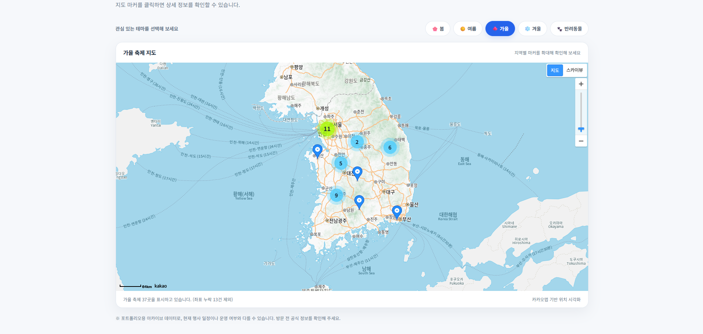
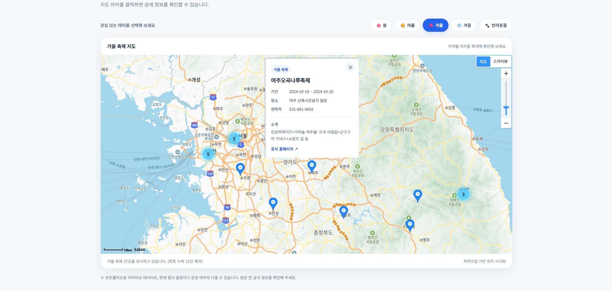
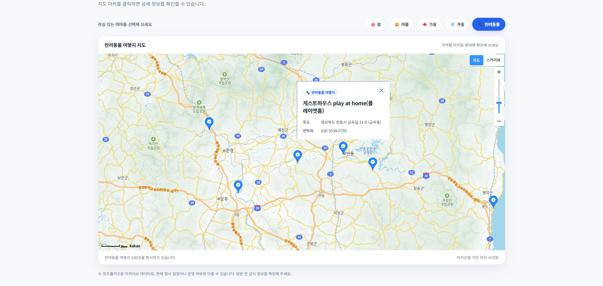

# Festival Map 🗺️

### 전국 축제 및 반려동물 동반 여행지 지도 서비스

**계절별 축제와 반려동물 동반 여행지를 지도 위에서 탐색할 수 있는 웹 프로젝트입니다.**

Kakao Maps API를 활용해 전국의 축제와 여행지 데이터를 지도에 시각화했습니다. 사용자는 계절별 필터를 통해 원하는 축제를 찾아보고, 지도 마커를 클릭해 상세 정보를 확인할 수 있습니다.

**[🌐 Live Demo](https://janalai3395.github.io/Festival/)**

---

## 01. 프로젝트 소개

전국 각지의 축제 정보를 보다 직관적으로 탐색할 수 있도록 지도 기반 웹 서비스를 구현했습니다.

단순히 축제 목록을 보여주는 대신 위치 정보를 지도 위에 표시하고, 계절별 분류와 마커 클러스터링을 적용해 여러 지역의 축제를 편리하게 확인할 수 있도록 구성했습니다.

또한 반려동물 동반 여행지 데이터를 함께 제공하여 다양한 테마의 여행지를 탐색할 수 있도록 했습니다.

### 주요 목표

- 전국 축제 및 여행지 데이터를 지도에 시각화
- 계절별 필터링을 통한 정보 탐색
- 마커 클러스터링으로 많은 위치 정보 관리
- 마커 클릭을 통한 상세 정보 제공
- 반응형 UI를 적용한 직관적인 화면 구성

## 02. 기술 스택

| 구분                      | 기술                                 |
| ------------------------- | ------------------------------------ |
| Frontend                  | HTML5, CSS3, JavaScript              |
| Map                       | Kakao Maps JavaScript API            |
| Data                      | JSON, 공공데이터 기반 축제·관광 정보 |
| Backend / Data Processing | Node.js                              |
| Deployment                | GitHub Pages                         |

## 03. 주요 기능

### 1. 전국 축제 지도 시각화

- 축제 데이터의 위도와 경도를 이용해 지도 마커 생성
- Kakao Maps API를 이용한 지도 및 마커 표시
- 마커 클러스터링으로 밀집된 지역의 축제 정보 관리

### 2. 계절별 축제 필터링

- 봄, 여름, 가을, 겨울 테마 선택
- 선택한 계절에 해당하는 축제 마커 표시
- 선택된 테마를 구분할 수 있는 버튼 UI 제공

### 3. 축제 상세 정보

마커 클릭 시 다음 정보를 확인할 수 있습니다.

- 축제 이름
- 개최 기간
- 개최 장소
- 축제 소개
- 연락처
- 홈페이지 링크(제공된 경우)

### 4. 반려동물 동반 여행지

- 반려동물 동반 여행지 위치 표시
- 장소명, 주소, 연락처 등 상세 정보 제공
- 축제 지도와 동일한 방식으로 마커 탐색

### 5. 반응형 사용자 인터페이스

- 미니멀한 카드형 UI
- 선택한 필터의 활성화 상태 표시
- 화면 크기에 따른 레이아웃 조정
- 데이터 로딩 및 오류 상태 안내

## 04. 실행 화면

### Main — 전국 축제 지도



계절별 테마를 선택하고 지도에 표시된 축제 위치를 확인할 수 있습니다.

### Festival Details — 축제 상세 정보



마커를 클릭하면 축제 기간, 장소, 소개 및 연락처 등의 정보를 볼 수 있습니다.

### Pet-Friendly Places — 반려동물 여행지



반려동물 동반 여행지를 지도에서 탐색하고 상세 정보를 확인할 수 있습니다.

## 05. 프로젝트 구조

```text
Festival/
├── index.html
├── data/
│   ├── festival.json
│   └── pet.json
├── scripts/
├── server.js
├── package.json
├── package-lock.json
├── screenshots/
│   ├── main.png
│   ├── festival-detail.png
│   └── pet-map.png
└── README.md
```

`screenshots/` 폴더는 README 이미지 표시를 위해 추가하는 폴더입니다.

## 06. 실행 방법

### 웹사이트에서 실행

[Festival Map 바로가기](https://janalai3395.github.io/Festival/)

### 로컬 환경에서 실행

**1. 저장소 복제**

```bash
git clone https://github.com/janalai3395/Festival.git
cd Festival
```

**2. 로컬 웹 서버 실행**

Python이 설치되어 있다면 다음 명령어를 사용할 수 있습니다.

```bash
python -m http.server 8000
```

**3. 브라우저 접속**

```text
http://localhost:8000
```

지도 표시를 위해 Kakao Maps API의 허용 도메인 설정이 필요합니다.

현재 공개 데모는 프로젝트에 포함된 정적 JSON 데이터를 사용하므로 별도의 데이터 수집 서버 실행 없이 이용할 수 있습니다.

## 07. 개발 및 개선 내용

- JSON 데이터 로딩을 통한 축제 및 관광 정보 표시
- 좌표 정보가 없는 데이터의 마커 생성 제외
- 필터 변경 시 기존 마커 초기화 및 재생성
- 정보창의 가독성을 고려한 카드형 UI 개선
- 데이터 로딩 실패 및 빈 데이터 안내
- GitHub Pages를 통한 정적 웹사이트 배포

## 08. 참고 사항

본 프로젝트는 공공데이터 기반의 축제 및 관광 정보를 활용한 포트폴리오 프로젝트입니다.

현재 공개 버전에서는 안정적인 시연을 위해 저장소에 포함된 JSON 데이터를 사용하며, 일부 축제 정보에는 과거 행사 일정이 포함되어 있습니다.

따라서 최신 행사 일정 확인을 위한 실시간 서비스가 아닌, **지도 기반 데이터 시각화와 탐색 기능을 보여주는 데모**입니다.

---

**Developed by [janalai3395](https://github.com/janalai3395)**
